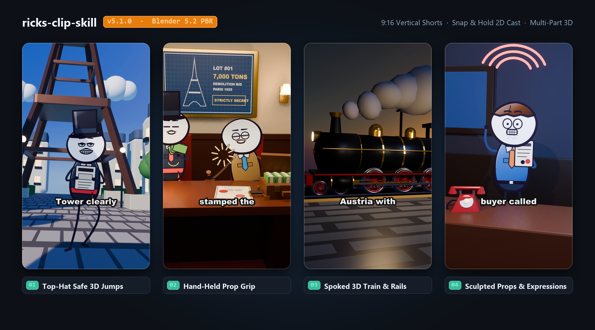
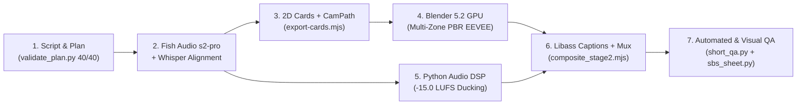

# ricks-clip-skill

**Agent skill and hybrid Blender 5.2 GPU + Remotion pipeline for 9:16 vertical animated story Shorts (`v5.1.0`).**

[](https://github.com/JosuaZxz/ricks-clip-skill/releases/tag/v5.1.0)
[](https://www.blender.org/)
[](https://www.remotion.dev/)
[](https://threejs.org/)
[](#)
[](./LICENSE)



`ricks-clip-skill` packages a 2D-cards-in-3D production pipeline that pairs outline-FREE multi-part PBR Blender 5.2 EEVEE worlds, 30fps on-ones bean-head sprites with bold ink contours, 40-check plan validation, Fish Audio `s2-pro` + Whisper word alignment, crisp pure white bold libass captions, and mastered SFX into self-contained YouTube Shorts (`1080x1920`, `30 fps`, `45-68 s`).

---

## Version History & What Changed (`v5.1.0`)

| Version | Focus | Key Upgrades |
| :--- | :--- | :--- |
| **`v5.1.0`** *(Current)* | Realism, Physics & Multi-Part 3D | Tall top-hat safe cards (`900x1680` / `designH: 1120` / `soleY: 1080`), 3-phase `jumpState` (6f knee crouch -> 3D `pos[1]` arc -> 7f landing absorb), grounded `"run"` feet, snap-and-hold acting without idle wobble, facing-aligned hand props (`sSide` stamp grip), and `bmesh` open-spoked wheels on unrotated XZ pivots synced with rods + I-beam tracks + sculpted rotary phones. |
| **`v5.0.0`** | Outline-FREE Blender PBR | Moved final rendering from Three.js toon cells to outline-FREE PBR Blender 5.2 EEVEE across 10-14 non-overlapping Y corridors, stylized sky ramps, `Fog Glow`, pure white `98px` libass captions, and `40/40` `validate_plan.py`. |
| **`v2.1.0`** | Kinetic Cast & Blender Stage-2 | Introduced kinetic 30fps batched PNG export (`export-cards.mjs`), Blender Stage-2 compositing (`composite_stage2.mjs`), and rubber-hose character controls. |
| **`v1.0.0`** | Initial Release | Stage-1 Three.js two-tone cel + `InkPass`, Remotion renderer, Fish Audio `s2-pro`, Whisper forced alignment, and `-15.0 LUFS` DSP mastering. |

---

## Included Skills

Both companion skills inside [`skills/`](./skills) share the upgraded `v5.1` engine, Blender/Remotion toolchain, references, and audio pipeline, tailored to different story prompts:

| Skill | Trigger Focus | Entry Point |
| :--- | :--- | :--- |
| **`ricks-clips-animation`** | True-history cons, bizarre incidents, and narrative Shorts in Ricks Clips style | [`skills/ricks-clips-animation/SKILL.md`](./skills/ricks-clips-animation/SKILL.md) |
| **`brain-snack-animation`** | Bite-sized science, engineering, and psychology paradox Shorts | [`skills/brain-snack-animation/SKILL.md`](./skills/brain-snack-animation/SKILL.md) |

---

## Pipeline Architecture



---

## Installation

### Option 1: Install via Skills CLI

```bash
npx skills add JosuaZxz/ricks-clip-skill
```

### Option 2: Manual Copy (Project or Global Scope)

Clone the repository and copy the desired folder(s) into your agent skills directory:

```bash
git clone https://github.com/JosuaZxz/ricks-clip-skill.git
```

- **Workspace scope:** copy `skills/ricks-clips-animation` (and optionally `skills/brain-snack-animation`) into `.agents/skills/`.
- **Global Antigravity / Gemini scope:** copy into `~/.agents/skills/` or `~/.gemini/config/skills/`.

---

## Quickstart (Starter Project)

### Prerequisites

- **Blender 5.2** on `PATH` (or custom executable passed to `blender_render.py`) for Stage-2 GPU renders
- **Node.js 18+** & **npm** (Chromium/Playwright used by `export-cards.mjs` and Remotion)
- **Python 3.10+** with packages: `numpy`, `scipy`, `faster-whisper`, `requests`, `pillow`
- **FFmpeg / FFprobe** available on `PATH`
- `FISH_API_KEY` set in your environment when synthesizing narration

### 1. Copy & Type-Check the Starter Template

```bash
cp -r skills/ricks-clips-animation/assets/starter my-short
cd my-short
npm install
npx tsc --noEmit
```

### 2. Synthesize Voiceover, Validate Plan & Build Mix

Set your API key via environment variable (never commit keys into repository files):

```bash
export FISH_API_KEY="your_fish_audio_api_key"
python scripts/gen_voice.py
python scripts/validate_plan.py public/plan.json public/audio/words.json
python scripts/make_audio.py
```

### 3. Export Kinetic Cards, Smoke-Preview in Blender & Render Final MP4

```bash
node scripts/export-cards.mjs --entry src/scene/cards.ts --story src/scene/story.ts --out out/cards
python scripts/blender_render.py --cards out/cards --frames-list 0,45,75 --engine EEVEE --samples 6 --format JPEG --out out/blender_preview
python scripts/blender_render.py --cards out/cards --frames 0-149 --engine EEVEE --samples 6 --format JPEG --out out/blender_frames
node scripts/composite_stage2.mjs --frames out/blender_frames --format jpg --audio public/audio/mix.wav --out out/final.mp4
python ../skills/ricks-clips-animation/scripts/short_qa.py out/final.mp4 out/qa public/plan.json
```

Fast Stage-1 Remotion WebGL blocking (`render-stills.mjs` / `render-video.mjs`) remains available inside `scripts/` for quick layout tests.

---

## Repository Structure

```text
ricks-clip-skill/
├── README.md
├── LICENSE
├── .gitignore
├── docs/
│   ├── showcase-v5.1.png             # Latest 4-panel v5.1.0 Blender 5.2 showcase
│   └── showcase.png                  # Synced latest preview image
└── skills/
    ├── ricks-clips-animation/
    │   ├── SKILL.md                  # End-to-end v5.1 execution workflow
    │   ├── assets/starter/           # Runnable Remotion + Blender + Python scaffold
    │   ├── references/
    │   │   ├── style-bible.md        # 7 film grammar laws & snap-and-hold rules
    │   │   ├── visual-spec.md        # Blender 5.2, headroom, jumpState & bmesh specs
    │   │   └── audio-tts.md          # Fish Audio s2-pro & mastering specs
    │   └── scripts/
    │       ├── blender_render.py     # Stage-2 Blender 5.2 GPU multi-zone renderer
    │       ├── composite_stage2.mjs  # Pure white libass captions & AAC muxer
    │       ├── export-cards.mjs      # Batched 2D Canvas2D sprites + camPath exporter
    │       ├── render-stills.mjs     # ANGLE-enabled Stage-1 still renderer
    │       ├── render-video.mjs      # ANGLE-enabled Stage-1 H.264 renderer
    │       ├── sbs_sheet.py          # Contact-sheet inspector
    │       ├── short_qa.py           # Automated video & loudness QA script
    │       └── validate_plan.py      # 40-check plan.json + words.json validator
    └── brain-snack-animation/        # Companion science/paradox workflow (v5.1)
```

---

## License

Released under the [MIT License](./LICENSE).
