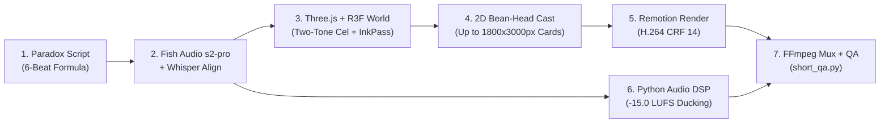

# ricks-clip-skill

**Agent skill and runnable 2.5D/3D cel-shaded Remotion + Three.js pipeline for 9:16 vertical animated explainer Shorts.**

[](https://www.remotion.dev/)
[](https://threejs.org/)
[](#audio--dsp-pipeline)
[](./LICENSE)


`ricks-clip-skill` packages a complete production pipeline that pairs two-tone cel-shaded 3D worlds, screen-space Sobel ink outlines, high-DPI procedural 2D bean-head actors, frame-accurate Fish Audio + Whisper word captions, and synthesized sound design into self-contained YouTube Shorts (`1080x1920`, `30 fps`, `45-68 s`).

---

## Included Skills

Both companion skills inside [`skills/`](./skills) share the upgraded HD engine, shader stack, and audio toolkit, triggered for slightly different storytelling niches:

| Skill | Trigger Focus | Entry Point |
| :--- | :--- | :--- |
| **`ricks-clips-animation`** | Narrative history, viral mechanics, and visual explainer Shorts in Ricks Clips style | [`skills/ricks-clips-animation/SKILL.md`](./skills/ricks-clips-animation/SKILL.md) |
| **`brain-snack-animation`** | Bite-sized science, engineering, and psychology paradox Shorts | [`skills/brain-snack-animation/SKILL.md`](./skills/brain-snack-animation/SKILL.md) |

---

## Pipeline Architecture



### Core Technical Stack

- **3D Cel & Ink Stack:** Custom `twoTone()` toon shading across `MeshLambertMaterial` and specular `MeshPhongMaterial`, view-space normal + depth `InkPass`, `NOINK` layer separation for crisp signage and character cards, and tuned `day` / `golden` lighting presets.
- **Distance-Tiered Character Crispness:** `charCanvasSize(dist)` renders close billboard actors up to `1800x3000 px` with directional contact blobs and sun shadow tails, keeping foreground ink lines sharp at 1080x1920.
- **Audio & Forced Alignment:** Python toolchain calling Fish Audio (`s2-pro`), trimming/tempo-fitting lines (`ffmpeg`), aligning every spoken word via `faster-whisper` (`words.json`), and synthesizing procedural music beds + frame-locked SFX mastered to `-15.0 LUFS` with automatic speech ducking.
- **Automated Quality Gate:** `short_qa.py` checks resolution, loudness (`LUFS` / true peak), silent spans, frozen frames (`>= 12f`), unintended flashes, and per-shot exposure stats before delivery.

---

## Installation

### Option 1: Install via Skills CLI

```bash
npx skills add JosuaZxz/ricks-clip-skill
```

### Option 2: Manual Copy (Project or Global Scope)

Clone the repository and copy the desired folder(s) into your agent skills directory:

```bash
git clone https://github.com/JosuaZxz/ricks-clip-skill.git
```

- **Workspace scope:** copy `skills/ricks-clips-animation` (and optionally `skills/brain-snack-animation`) into `.agents/skills/`.
- **Global Antigravity / Gemini scope:** copy into `~/.agents/skills/` or `~/.gemini/config/skills/`.

---

## Quickstart (Starter Project)

### Prerequisites

- **Node.js 18+** & **npm**
- **Python 3.10+** with packages: `numpy`, `scipy`, `faster-whisper`, `requests`, `pillow`
- **FFmpeg / FFprobe** available on `PATH`
- `FISH_API_KEY` set in your environment when synthesizing narration

### 1. Copy & Type-Check the Starter Template

```bash
cp -r skills/ricks-clips-animation/assets/starter my-short
cd my-short
npm install
npx tsc --noEmit
```

### 2. Synthesize Voiceover & Word Timings

Set your API key via environment variable (never commit keys into repository files):

```bash
export FISH_API_KEY="your_fish_audio_api_key"
python scripts/gen_voice.py
```

### 3. Build Audio Mix & Inspect Preview Stills

```bash
python scripts/make_audio.py
node scripts/render-stills.mjs --comp MainShort --out out/stills --scale 0.75 12 45 76 120
```

### 4. Render Final MP4 & Run QA

```bash
node scripts/render-video.mjs --comp MainShort --out out/video_raw.mp4
ffmpeg -y -i out/video_raw.mp4 -i public/audio/mix.wav -map 0:v -map 1:a -c:v copy -c:a aac -b:a 192k -ar 48000 -movflags +faststart -shortest out/final_short.mp4
python ../skills/ricks-clips-animation/scripts/short_qa.py out/final_short.mp4 out/qa
```

---

## Repository Structure

```text
ricks-clip-skill/
├── README.md
├── LICENSE
├── .gitignore
├── docs/
│   └── showcase.png                  # Rendered 9:16 frame showcase
└── skills/
    ├── ricks-clips-animation/
    │   ├── SKILL.md                  # End-to-end execution workflow
    │   ├── assets/starter/           # Runnable Remotion + R3F + Python scaffold
    │   ├── references/
    │   │   ├── style-bible.md        # 6-beat paradox script & camera rules
    │   │   ├── visual-spec.md        # Shader stack, HD rules, NOINK contract
    │   │   └── audio-tts.md          # Fish Audio s2-pro & mastering specs
    │   └── scripts/
    │       ├── render-stills.mjs     # ANGLE-enabled Remotion still renderer
    │       ├── render-video.mjs      # ANGLE-enabled Remotion H.264 renderer
    │       ├── short_qa.py           # Automated video & loudness QA script
    │       └── sbs_sheet.py          # Contact-sheet inspector
    └── brain-snack-animation/        # Companion science/paradox trigger alias
```

---

## License

Released under the [MIT License](./LICENSE).
